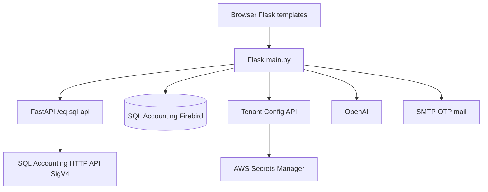

# eQuotation

Quotation, RFQ, and supplier-portal application for SQL Accounting, with a Flask UI and a FastAPI SQL Accounting API layer.

## Overview

eQuotation lets customers create and submit quotations, staff review them, and suppliers bid on RFQs. Data is stored in a SQL Accounting Firebird company file. Optional OpenAI integration supports conversational order/quotation assistance. Tenant Firebird and SQL Accounting HTTP API credentials are loaded from a tenant-config API and AWS Secrets Manager.

It is intended for companies that already use SQL Accounting and need a browser portal for customers, staff, and suppliers rather than desktop-only quotation entry.

## Key Features

- Role-based sign-in: Customer, Admin/staff, Supplier, plus guest sign-in
- Email OTP for registered roles
- Create, draft, submit, review, and cancel quotations
- Procurement / RFQ flow for suppliers (`routes/procurement_routes.py`)
- FastAPI SQL Accounting HTTP API (SigV4) mounted under `/eq-sql-api`
- Firebird company-file integration (`fdb`)
- OpenAI chat / product-intent helpers
- Tenant bootstrap (Dynamo-backed HTTP API) and Secrets Manager credential refs
- PHP compatibility endpoints under `php/` for older clients
- User guide screenshots in `docs/`

## Architecture



Flask serves pages and session auth. FastAPI handles SQL Accounting REST operations. Firebird remains the company book; the official SQL Accounting HTTP API is used for quotation posting when configured.

## Tech Stack

- Python 3 / Flask 3
- FastAPI + Uvicorn + Pydantic
- Firebird via `fdb`
- OpenAI Python SDK
- botocore (Secrets Manager)
- Optional PHP scripts under `php/`

## Setup

1. Create a virtual environment and install dependencies:

```powershell
python -m venv .venv
.\.venv\Scripts\activate
pip install -r requirements.txt
```

2. Copy [`.env.example`](.env.example) to `.env` and fill `TENANT_CODE`, `TENANT_BOOTSTRAP_API_URL`, `DB_PASSWORD`, and `FLASK_SECRET_KEY`. See also [`.env.example.api`](.env.example.api) for API keys.
3. For local work without AWS, set `TENANT_BOOTSTRAP_SKIP_SECRETS=1` and supply `DB_*` / `SQL_API_*` in `.env`.
4. Run:

```powershell
python main.py
```

Default UI port is `FLASK_PORT` (8880). FastAPI is mounted at `EQ_SQL_API_MOUNT_PATH` (`/eq-sql-api`).

More detail: [`docs/setup.md`](docs/setup.md), [`docs/FIREBIRD_SETUP.md`](docs/FIREBIRD_SETUP.md), [`docs/FASTAPI_SETUP.md`](docs/FASTAPI_SETUP.md), [`docs/AUTH_SETUP.md`](docs/AUTH_SETUP.md).

## Testing

```powershell
pip install -r requirements-dev.txt
pytest
```

## Security

- Never commit `.env` or `appsettings.Local.json`.
- `FLASK_SECRET_KEY` in `appsettings.json` is a development placeholder only.
- Rotate any tenant API URL or Firebird password that previously lived in public git history.

## License

[ADD INFORMATION]
