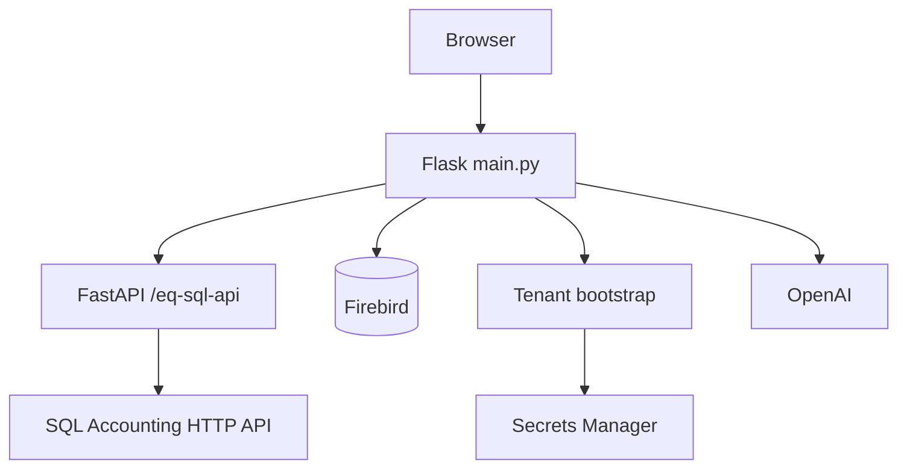

# Architecture

eQuotation is a Flask UI plus a FastAPI layer. `python main.py` serves Flask on `FLASK_PORT` and mounts FastAPI at `EQ_SQL_API_MOUNT_PATH` (`/eq-sql-api` by default). Firebird is the company book. Optional SQL Accounting HTTP API (SigV4) posts quotations. Tenant records come from a configurable HTTP API; secrets from AWS Secrets Manager.

Routes: `routes/` (Flask pages), `api/routes/` (FastAPI). Auth: `routes/auth_routes.py` and `api/routes/auth.py`.

See also [FASTAPI_SETUP.md](FASTAPI_SETUP.md), [AUTH_SETUP.md](AUTH_SETUP.md), [FIREBIRD_SETUP.md](FIREBIRD_SETUP.md), [ENTERPRISE.md](ENTERPRISE.md).
